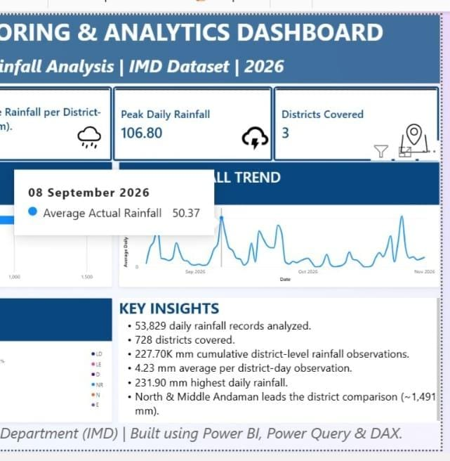
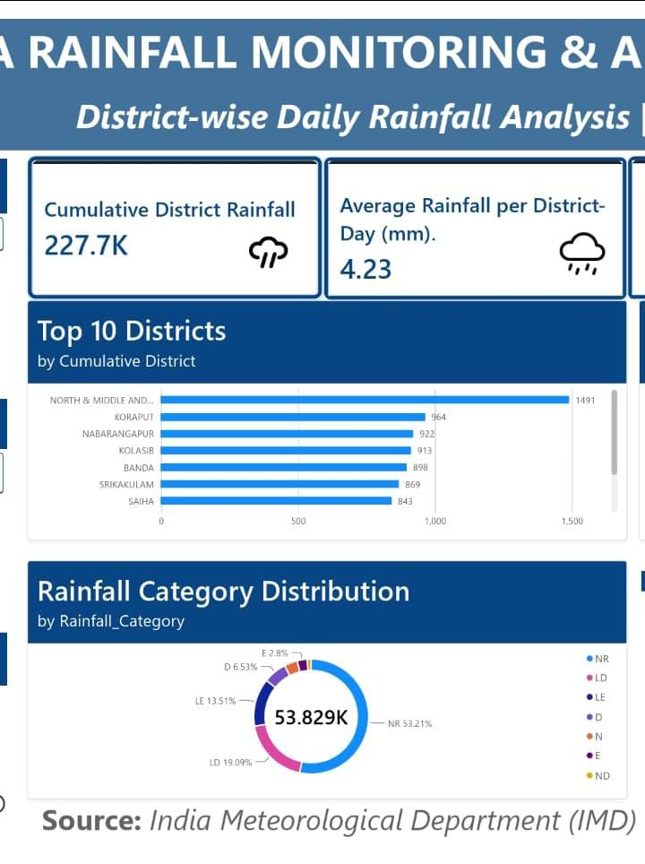
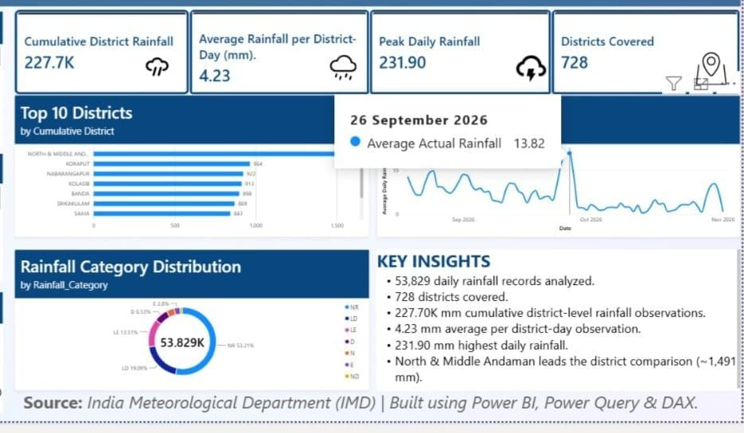

# India Rainfall Monitoring & Analytics Dashboard

An interactive Power BI dashboard developed to analyze district-wise daily rainfall data from the India Meteorological Department (IMD), Government of India.

## Project Overview

This project focuses on exploring rainfall patterns across Indian districts through interactive visualizations. It allows users to compare districts, monitor rainfall indicators, and analyze daily rainfall variations.

## Dataset Information

- **Dataset Source:** India Meteorological Department (IMD)
- **Total Records:** 53,829
- **Districts Covered:** 728
- **States and Union Territories:** 39
- **Dataset Fields:** State, District, Date, Actual Rainfall, Normal Rainfall, Departure Percentage, and Rainfall Category.

## Tools & Technologies

- Power BI
- Power Query
- DAX
- Data Cleaning
- Data Modelling
- Data Visualization

## Dashboard Features

- KPI cards displaying key rainfall indicators.
- Top 10 district rainfall comparison.
- Daily rainfall trend analysis.
- Rainfall category visualization.
- Interactive State, District, and Date filters.

## Dashboard Screenshots

### 1. Dashboard Overview

### 2. KPI Analysis

### 3. Key Analysis

### 4. District Comparison

### 5. Rainfall Charts

## Project Files

- [Download Power BI Dashboard](india%20rainfall%20analysis.pbix)
- [View Dashboard PDF](india%20rainfall%20analysis.pdf)

## Key Learning Outcomes

- Working with real-world government datasets.
- Cleaning and transforming data using Power Query.
- Creating analytical measures using DAX.
- Building interactive dashboards.
- Presenting data-driven insights through visualizations.

## Project Note

This project focuses on descriptive rainfall analysis. It does not include rainfall forecasting or prediction.

